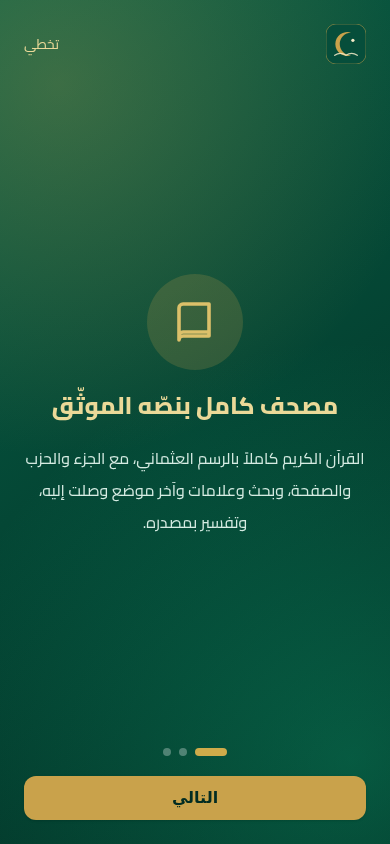
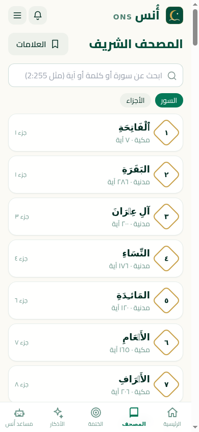

# أُنس | ONS

**بالقرب من القرآن تحيا القلوب.** تطبيق إسلامي عربي (RTL) يجمع المصحف والتلاوات والتفسير والورد اليومي وختم القرآن والحفظ والمراجعة والأذكار والمسبحة والأدعية.

**التطبيق يعمل الآن:** https://ons-quran.onrender.com

> English: ONS is a free, installable Arabic Quran web app (PWA). Full Mushaf, daily wird, khatma planner, adhkar and duas, last-read position and bookmarks. Stack: FastAPI, React + Vite + Tailwind, PostgreSQL. Live demo above.

<p align="center">
  
  
</p>

## المميزات
- المصحف كاملاً (6236 آية) بالرسم العثماني مع الجزء والحزب والصفحة والبحث
- قراءة صفحة بصفحة بشكل المصحف (٦٠٤ صفحة) مع زر «التالي» بعد إنهاء كل صفحة، وسحب لقلب الصفحة، وثلاثة ألوان للورق (فاتح، سيبيا، ليلي)، وتسجيل تقدّم الختمة تلقائياً
- مشاركة أي آية كصورة جاهزة، وآية اليوم في الرئيسية
- آخر موضع قراءة تلقائي وعلامات مرجعية
- خطة ختمة ومتابعة التقدم، وورد يومي
- الأذكار والأدعية من مصادر موثقة
- يعمل بدون إنترنت بعد أول فتح (المصحف والأذكار والأدعية والعلامات)، ويتحدّث تلقائياً مع كل إصدار

## تثبيت التطبيق على الموبايل
- **أندرويد (Chrome):** افتح الرابط، ثم النقاط الثلاث، ثم Add to Home screen / Install app.
- **آيفون (Safari):** زر المشاركة، ثم Add to Home Screen.

أول فتح بعد فترة خمول قد يستغرق حوالي نصف دقيقة (الاستضافة المجانية تنام).

## التشغيل السريع

```bash
./run.sh            # يبني الواجهة ويشغّل كل شيء على http://localhost:8000
```

أو يدوياً:

```bash
cd frontend && npm install && npm run build
cd ../backend && pip install -r requirements.txt
ONS_SECRET_KEY=$(python3 -c 'import secrets;print(secrets.token_hex(32))') uvicorn app.main:app --port 8000
```

للتطوير: شغّل الـ backend على 8000 ثم `cd frontend && npm run dev` (المنفذ 5173، ويمرّر /api تلقائياً).

### PostgreSQL / Docker
`ONS_SECRET_KEY=... docker compose up --build` يشغّل التطبيق مع PostgreSQL. بدون `DATABASE_URL` يستخدم SQLite. **تنبيه:** اختبارات هذا المشروع شُغّلت على SQLite فقط، ولم يُجرَّب تشغيل PostgreSQL فعلياً.

## الاختبارات
```bash
cd backend && python3 -m pytest -q            # 25 اختباراً: البيانات، الـ API، الحسابات، الختمة، الحفظ، المساعد
cd frontend && npm test                       # اختبارات Vitest للوحدات
cd frontend && npm run build && (شغّل الخادم) && node e2e/smoke.mjs   # اختبار شامل في Chrome (يتطلب puppeteer-core وChrome)
```

## البنية
```
backend/app   FastAPI: main.py (الواجهات)، db.py (الجداول)، content.py (البيانات والبحث)، assistant.py (المساعد)، security.py (JWT وكلمات المرور)
backend/data  quran.json (6236 آية + التفسير)، adhkar.json (حصن المسلم)، nawawi.json (الأربعون النووية)
frontend/src  React + Vite + Tailwind: pages/ (الشاشات)، components/، store.jsx، audio.jsx
scripts/fetch_data.py  يعيد بناء ملفات البيانات من المصادر الأصلية
```

## مصادر المحتوى (لا نصوص مولّدة)
- **نص القرآن** بالرسم العثماني: api.alquran.cloud (إصدار quran-uthmani، من مشروع Tanzil). الجزء/الحزب/الصفحة (مصحف المدينة، 604 صفحة) من نفس المصدر.
- **التفسير:** التفسير الميسر (مجمع الملك فهد) وتفسير الجلالين، عبر api.alquran.cloud (ar.muyassar وar.jalalayn).
- **التلاوات:** cdn.islamic.network (آية بآية: العفاسي، الحصري، المنشاوي، المعيقلي، الحذيفي، محمد أيوب). تحتاج إنترنت.
- **الأذكار:** حصن المسلم عبر مستودع rn0x/Adhkar-json.
- **الحديث:** الأربعون النووية (42 حديثاً) عبر fawazahmed0/hadith-api.
- **الأدعية القرآنية:** مراجع آيات فقط، والنص يُقرأ من بيانات المصحف نفسها.

## المساعد
مساعد «استرجاع» لا «توليد»: يبحث (BM25 على نص الآيات والتفسير الميسر وحصن المسلم والأربعين النووية) ويعرض النصوص كما هي مع مصدرها. لا يخترع آية أو حديثاً، يرفض الفتاوى، ويقول «لم أجد» عند غياب المصدر. لا يحتاج مفتاح API. (إضافة نموذج لغوي لصياغة الإجابة ممكنة مستقبلاً بشرط بقاء الاقتباسات من البيانات.)

## الأمان
كلمات المرور PBKDF2-SHA256 (200 ألف دورة)، JWT، تحقق من المدخلات (Pydantic)، تحديد معدل المحاولات (في الذاكرة)، رؤوس أمان، عزل بيانات المستخدمين. غيّر `ONS_SECRET_KEY` قبل أي نشر.

## ما ينقص (بصراحة)
انظر `REPORT.md`.

## Offline use
The app is an installable PWA. After the first visit the service worker saves the app shell and all Quran text, adhkar and duas on the device, so these open with no internet. Last-read position and bookmarks work offline (kept on the device; signed-in users sync when back online). Needs internet: audio, search, AI assistant, tafsir for ayahs not opened before, account actions. A new deploy updates installed copies automatically.
